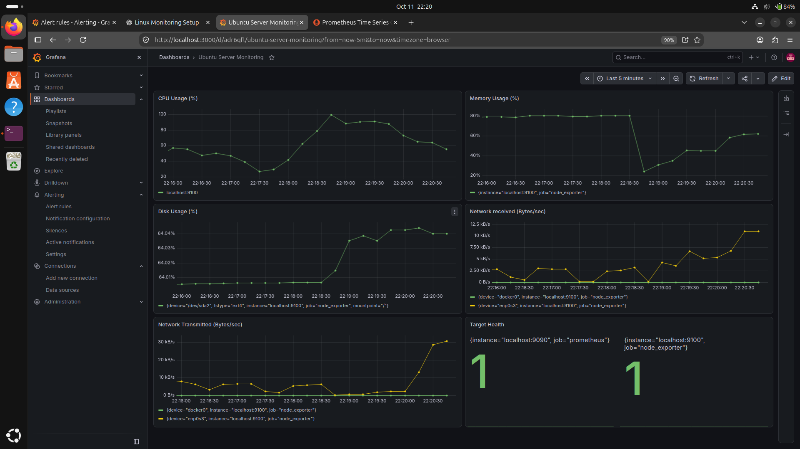
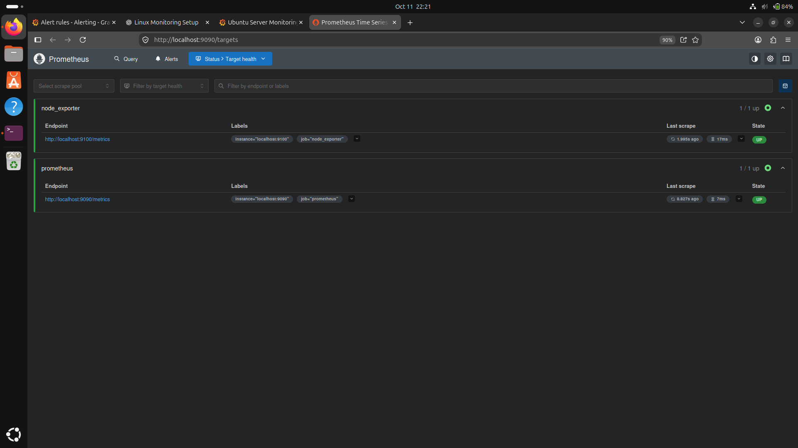
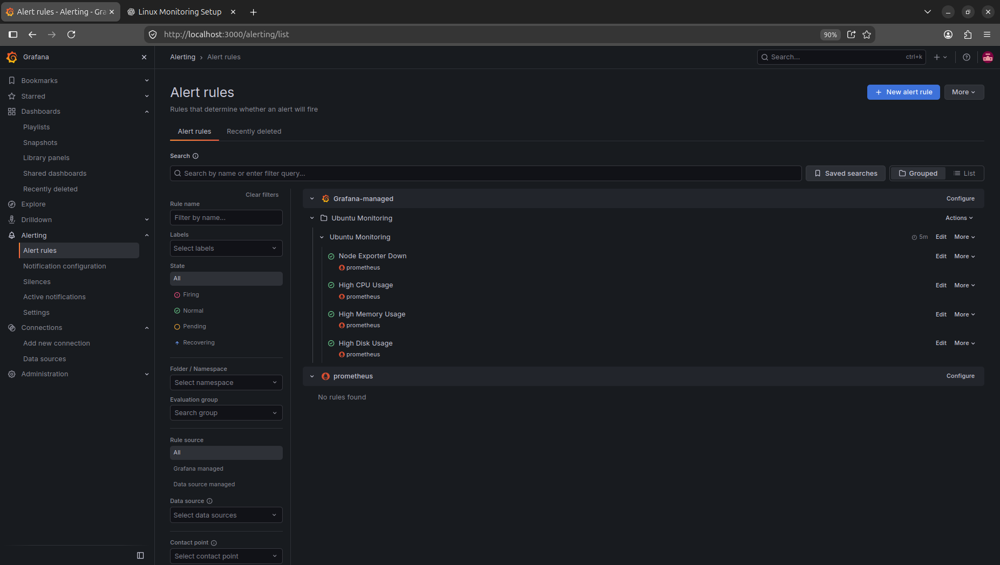

# Ubuntu Server Monitoring

A Linux server monitoring project built with **Prometheus, Node Exporter, and Grafana**. The project collects Ubuntu system metrics, visualizes performance in a Grafana dashboard, and uses alert rules to identify potential problems.

## Project Overview

The objective of this project is to monitor the performance and availability of an Ubuntu server using an open-source monitoring stack.

The setup collects server metrics, presents them through Grafana visualizations, and evaluates alert conditions using Prometheus data.

## Architecture

```text
                 Ubuntu Linux VM
                       |
                Node Exporter
                  Port 9100
                       |
                       v
                  Prometheus
                  Port 9090
                       |
              Prometheus Data Source
                       |
                       v
                    Grafana
                  Port 3000
                       |
                       v
              Monitoring Dashboard
```

### Technology Stack

| Technology | Purpose |
|---|---|
| Ubuntu Linux | Operating system being monitored |
| Prometheus | Collects and stores time-series metrics |
| Node Exporter | Exposes Linux system metrics |
| Grafana | Visualizes metrics and evaluates alert rules |
| PromQL | Queries monitoring data |
| Git and GitHub | Version control and project documentation |

## Dashboard

The Grafana dashboard is named **Ubuntu Server Monitoring**.

It includes the following panels:

| Panel | Purpose |
|---|---|
| CPU Usage (%) | Displays CPU utilization over time |
| Memory Usage (%) | Displays memory usage based on available RAM |
| Disk Usage (%) | Displays usage of the root filesystem |
| Network Received | Displays incoming network traffic |
| Network Transmitted | Displays outgoing network traffic |
| Target Health | Displays Prometheus scrape target status |

## Prometheus Configuration

The Prometheus configuration file is:

```text
/etc/prometheus/prometheus.yml
```

The configuration uses a 15-second scrape interval and monitors Prometheus itself and Node Exporter.

```yaml
global:
  scrape_interval: 15s
  evaluation_interval: 15s

scrape_configs:
  - job_name: "prometheus"
    static_configs:
      - targets: ["localhost:9090"]

  - job_name: "node_exporter"
    static_configs:
      - targets: ["localhost:9100"]
```

## PromQL Queries

### 1. CPU Usage

Calculates CPU utilization using the rate of change of the idle CPU counter.

```promql
100 * (1 - avg by (instance) (
  rate(node_cpu_seconds_total{
    job="node_exporter",
    mode="idle"
  }[1m])
))
```

### 2. Memory Usage

Calculates memory usage based on the memory available to applications.

```promql
100 * (
  1 -
  node_memory_MemAvailable_bytes{job="node_exporter"}
  /
  node_memory_MemTotal_bytes{job="node_exporter"}
)
```

### 3. Root Filesystem Usage

Calculates the percentage of the root filesystem that is used.

```promql
100 * (
  1 -
  node_filesystem_avail_bytes{
    job="node_exporter",
    mountpoint="/",
    fstype!~"tmpfs|overlay"
  }
  /
  node_filesystem_size_bytes{
    job="node_exporter",
    mountpoint="/",
    fstype!~"tmpfs|overlay"
  }
)
```

### 4. Incoming Network Traffic

```promql
rate(node_network_receive_bytes_total{
  job="node_exporter",
  device!="lo"
}[1m])
```

### 5. Outgoing Network Traffic

```promql
rate(node_network_transmit_bytes_total{
  job="node_exporter",
  device!="lo"
}[1m])
```

### 6. Target Health

```promql
up
```

A value of `1` indicates a successful scrape. A value of `0` indicates a failed scrape.

## Alert Rules

Four alert rules have been created in Grafana under the `Ubuntu Monitoring` folder.

| Alert Rule | Condition | Pending Period |
|---|---|---|
| Node Exporter Down | `up{job="node_exporter"}` is below 1 | 5 minutes |
| High CPU Usage | CPU usage is above 80% | 5 minutes |
| High Memory Usage | Memory usage is above 85% | 5 minutes |
| High Disk Usage | Disk usage is above 85% | 5 minutes |

The rules were observed in the Normal state when the relevant thresholds were not exceeded. A temporary test rule was also used to confirm that Grafana could enter the Firing state, then removed.

**Notification status:** External notification delivery has not been configured. The contact point is intentionally left empty.

## Service Management

The following systemd services are used:

```bash
sudo systemctl status prometheus
sudo systemctl status node_exporter
sudo systemctl status grafana-server
```

Check whether each service is enabled at boot:

```bash
systemctl is-enabled prometheus
systemctl is-enabled node_exporter
systemctl is-enabled grafana-server
```

Check service status:

```bash
systemctl is-active prometheus
systemctl is-active node_exporter
systemctl is-active grafana-server
```

All three services were verified as active and enabled at boot.

## Validation and Testing

The following checks have been completed:

- Verified that Prometheus and Node Exporter targets were UP.
- Confirmed that metrics were visible in Grafana.
- Created and reviewed four alert rules.
- Confirmed that a temporary test rule entered the Firing state.
- Removed the temporary test rule after verification.
- Restarted the Ubuntu VM and confirmed that all three services became active again.
- Confirmed that the monitoring targets and dashboard resumed operation after the restart.

## Accessing the Services

When accessing the services from the Ubuntu VM:

| Service | URL |
|---|---|
| Grafana | http://localhost:3000 |
| Prometheus | http://localhost:9090 |
| Prometheus Targets | http://localhost:9090/targets |
| Node Exporter Metrics | http://localhost:9100/metrics |

## Future Improvements

- Configure email or another notification contact point.
- Test the firing and recovery behavior of each real alert.
- Improve dashboard organization and add additional system metrics.
- Document further troubleshooting and recovery scenarios.

## Skills Demonstrated

- Linux system administration
- Prometheus configuration and monitoring
- Node Exporter setup
- Grafana dashboards and alert rules
- PromQL queries
- systemd service management
- Troubleshooting and reboot recovery
- Git and GitHub version control

---

**Project:** Ubuntu Server Monitoring  
**Repository:** `ubuntu-server-monitoring`

## Screenshots

### Grafana Monitoring Dashboard

The dashboard visualizes CPU usage, memory usage, disk usage, network traffic, and target health.



### Prometheus Targets

Both Prometheus and Node Exporter targets should be UP when metrics collection is working correctly.



### Grafana Alert Rules

The project includes alert rules for Node Exporter availability, CPU usage, memory usage, and disk usage.


